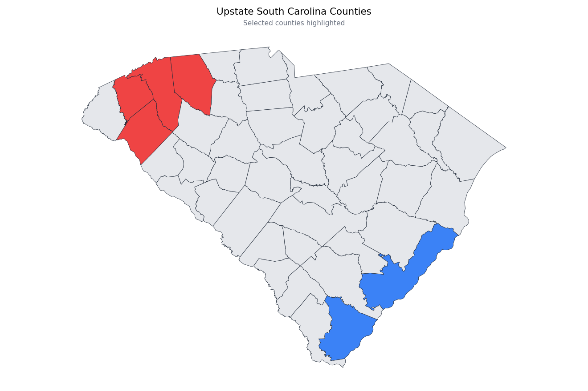

# Python Map Studio

**Build and style U.S. county choropleth maps without writing code — while real
`geopandas`, `shapely`, `pyproj` and `matplotlib` run entirely in your browser.**

**Live: <https://pythonmaps.pattygcoding.com/>**

No server renders a single pixel. The page boots a Python interpreter compiled to
WebAssembly (Pyodide), installs the geospatial stack into its virtual filesystem,
and executes genuine `GeoDataFrame` operations. Every control in the form
regenerates the Python that produces the map, and the drawer shows you that exact
script — ready to copy and run on a desktop.

| | |
| --- | --- |
| **Runtime** | Pyodide 314.0.7 — Python 3.14.2, via WebAssembly |
| **Geospatial** | geopandas 1.1.3 · shapely 2.1.2 · pyproj 3.7.2 · fiona 1.10.1 |
| **Plotting** | matplotlib 3.10.8 (Agg) |
| **Frontend** | Svelte 5 + TypeScript + Vite, Tailwind CSS v4 |
| **Backend** | none — static files on GitHub Pages |

---

## What it does

**Scope** — the contiguous Lower 48 (3,109 counties), or any single state by FIPS code.

**Highlight groups** — add as many as you like; each has a fill colour (presets or
a hex value) and a list of counties. Because county names repeat across states
(Greenville exists in both South Carolina and Alabama), a rule accepts a
two-letter qualifier: `Greenville, SC`. Only two-letter codes count, because
plenty of full state names are also county names — Washington, Nevada, Idaho,
Delaware — and guessing between the two would silently paint the wrong counties.

**Everything else** — base and border colours, border width, map background,
title and subtitle with independent sizes, county labels, figure dimensions, and
four projections.

**County labels** use `representative_point()` rather than the centroid, so a
label can never land outside the polygon it belongs to.

**Diagnostics** — after every render, the worker reports how many counties each
rule matched and names any county that matched *nothing*. A typo would otherwise
produce a silently blank map with no clue why.

**Exports** — a 300 dpi PNG, or a vector SVG re-saved from the retained figure, so
exporting never recomputes the map.

---

## How it works

```
index.html ─ Python Map Studio
      │
      ▼
src/lib/pyscript.ts ─ config ─▶ Python source      ◀── single source of truth
      │                       (imported by BOTH sides)
      ├───────────▶ CodeDrawer.svelte   shows it live, on every keystroke
      │
      └───────────▶ src/worker/pyodide.worker.ts
                          │  loadPyodide() + loadPackage(['geopandas','matplotlib'])
                          │  fetch + parse the boundaries once ─▶ BOUNDARIES
                          │  runPythonAsync(script)
                          ▼
                    { base64 PNG, stats } ─▶ MapCanvas.svelte
```

The one design decision worth calling out: **the code drawer and the worker import
the same `generateScript()`.** The original brief called for sending form JSON to
the worker and having it return the script it ran, which is what happens — but
because both sides share one generator, the script on screen is byte-identical to
the script that executed, *and* the drawer can update instantly on every keystroke
without a worker round-trip. A separately maintained copy of the script would have
drifted the first time either side changed.

### Why the worker boots once

The worker stays alive for the life of the page, and it now does three things once
that used to be paid repeatedly:

- **The boundaries are parsed once.** `gpd.read_file` on the 3.79 MB GeoJSON
  measured **0.6–0.8 s**, and the generated script used to call it on *every*
  render. The worker parses it at start-up and exposes it as `BOUNDARIES`; the
  generated script prefers that frame and falls back to reading the file, so it
  still runs on a desktop. The same map costs **0.14–0.22 s** in the studio against
  **0.7–0.95 s** standalone — that gap is the per-render cost this removes.
- **The dataset download overlaps the runtime install.** The fetch is a 3.79 MB
  download the browser handles off-thread, so it starts before `loadPyodide` and
  is awaited only when the boundaries are needed — hiding essentially all of it
  behind work that was happening anyway.
- **Exports reuse the retained figure.** PNG-300 and SVG are a re-`savefig`, not a
  re-render.

Renders are serialised and only the **newest** queued configuration is computed —
dragging a slider queues one job, not thirty. Every result carries an id, so a
superseded render is discarded instead of flashing onto the canvas.

### What is actually slow

`scripts/profile_python.mjs` times every phase, because the expensive parts are
not where they look:

| Phase | Measured | Notes |
| --- | --- | --- |
| `import geopandas` | ~2.4 s | pulls pandas, shapely, pyproj and fiona |
| `import matplotlib` + pyplot | ~1.3 s | |
| `gpd.read_file` (3.79 MB) | ~0.6–0.8 s | now paid once, at boot |
| `to_crs` (3,109 counties) | ~35 ms | negligible — not worth caching |
| `representative_point` (all) | ~6 ms | negligible |
| `apply(axis=1)` colouring | ~19 ms | a vectorised form saves 16 ms; not worth diverging from the original scripts |
| plot + layout, Lower 48 | ~480 ms | 3,109 real polygon patches — close to inherent |
| `savefig` png | ~100–165 ms | |

So the Lower 48 render is about **0.8 s** and a single state about **0.2 s**, and
the dominant costs are matplotlib drawing the polygons and the one-off imports.
The boot's longest single step is `import geopandas`, which is why the import phase
is reported in two labelled stages rather than appearing as a stalled bar.

---

## Notes on the implementation

Everything here was verified against a real runtime rather than assumed. Five
details are worth knowing, because four of them contradict what you would expect.

**Pyodide requires a module worker.** Its loader is an ES module, and its
documentation is explicit that classic workers using `importScripts()` are no
longer supported. The worker is therefore created with `{ type: 'module' }` and
Vite is configured with `worker.format: 'es'` — the default IIFE bundle would
silently break it.

**`micropip` is not needed.** geopandas, shapely, pyproj, fiona and matplotlib are
all first-class Pyodide packages, so `loadPackage(['geopandas', 'matplotlib'])`
resolves the entire dependency chain from the runtime's own lockfile. No
compilation, no PyPI round-trip.

**`read_file` is told `engine="fiona"` explicitly.** Upstream geopandas 1.x
prefers `pyogrio`, which is absent from Pyodide; without the explicit engine,
geopandas probes for pyogrio, fails, and falls back with a warning. Relatedly:
`gpd.read_file()` on the Census shapefile **`.zip` URL** that the original scripts
used cannot be carried over — there is no guaranteed GDAL `/vsizip/` support in
WASM, so the dataset is GeoJSON.

**Projections genuinely work offline.** Pyodide's pyproj build vendors PROJ 9.6.2
*and* its `proj.db`, so `to_crs()` needs no network. Both `EPSG:5070` and
`ESRI:102003` resolve at runtime — the picker still probe-gates the ESRI option,
and hides it if a future PROJ build drops the ESRI records.

**TIGERweb's `NAME` is not the county name.** The service returns
`NAME: "Cherokee County"` with `BASENAME: "Cherokee"`. The natural
`row["NAME"] in ["Cherokee", ...]` test therefore matches *nothing*. The data
pipeline remaps `NAME` to the basename and preserves the full label as
`NAMELSAD`.

Measured on the committed dataset, in the browser's own runtime:

| Render | Counties | Time |
| --- | --- | --- |
| South Carolina, Albers 5070 | 46 | ~0.7 s |
| Lower 48, Albers 5070 | 3,109 | ~1.2 s |
| SVG export (3,155 vector paths) | — | ~0.5 s |

### Honest caveats

- **First load is heavy** — roughly 30 MB of WebAssembly, because a Python
  interpreter plus numpy, pandas, shapely, pyproj, fiona and matplotlib is not a
  small thing. Subsequent visits are served from cache; the Pyodide version is
  pinned so the CDN cache key never changes under you.
- **A running render cannot be cancelled.** That needs `SharedArrayBuffer`, which
  needs COOP/COEP headers, which GitHub Pages cannot send. The button is disabled
  while a render is in flight and stale results are discarded instead.
- **`file://` will not work** — workers and `fetch` are blocked on the file
  scheme. Serve the directory over HTTP.

---

## Local development

```bash
npm install
npm run dev          # http://localhost:5173
```

```bash
npm run check        # svelte-check: types in .ts and .svelte
npm run build        # static output in dist/
npm run preview      # serve dist/ on http://localhost:4173
```

## The boundary dataset

`public/data/us_counties.geojson` is **committed**, so the site build never
contacts the Census Bureau. It is 3,235 counties, 170,232 vertices, 3.79 MB raw
and about 1.07 MB gzipped.

```bash
python scripts/build_data.py            # regenerate (stdlib only, no deps)
python scripts/build_data.py --help     # tolerance, precision, ring threshold
python scripts/inspect_data.py          # validate the committed file
```

`build_data.py` pages through [TIGERweb][] layer `State_County/MapServer/1`
(Counties, January 2026 vintage, public domain), normalises the attributes,
simplifies each ring with Douglas–Peucker and rounds coordinates to four decimal
places. Downloaded pages are cached under `scripts/.cache/`, so re-running after a
tolerance tweak takes seconds rather than minutes.

The geometry budget was chosen from measurements rather than taste — gzipped size
against simplification tolerance:

| Tolerance | Raw | Gzipped | Median vertices/county |
| --- | --- | --- | --- |
| 0.008° | 2.21 MB | 587 KB | 20 |
| **0.003° (default)** | **3.79 MB** | **1.07 MB** | **38** |
| 0.002° | 4.82 MB | 1.39 MB | — |

Because the boundaries are negligible next to Pyodide's ~30 MB, spending bytes on
geometry is close to free; 0.003° was the point where coastlines stopped looking
faceted. The gzipped figure is what actually crosses the wire.

Two details the simplifier handles carefully: a closed ring is split at the vertex
farthest from its start before simplification (anchoring a ring on one point makes
Douglas–Peucker degenerate, since the reference segment has zero length), and the
largest polygon of a multi-part county is always retained, so a blanket "drop
rings under N" rule cannot delete a genuinely tiny county such as Falls Church
City, Virginia.

[TIGERweb]: https://tigerweb.geo.census.gov/arcgis/rest/services/TIGERweb

---

## Verification

The riskiest part of this project is the Python that `generateScript()` emits: it
is written by hand inside a TypeScript template, so a typo would only appear as a
runtime error in a user's browser. `scripts/verify_python.mjs` closes that gap by
booting Pyodide **in Node** and executing the generator's real output against the
real GeoJSON.

```bash
npm run verify:python     # or: node --experimental-strip-types scripts/verify_python.mjs
npm run verify            # type-check + build + the above
```

It reports the runtime probe (resolved package versions, which CRS strings resolve,
whether matplotlib can draw text at all) and then runs seven configurations,
asserting each produces a non-empty PNG, the expected county count, and no
unmatched county names. It also confirms the SVG export is genuine vector output
rather than an embedded raster. It is deliberately outside the deploy path — the
site build never runs it.

```bash
node --experimental-strip-types scripts/verify_python.mjs docs/preview.png
```

...additionally writes the default view out, which is how `docs/preview.png` at the
top of this file is produced.

### Reproducible builds

`.gitattributes` pins `eol=lf` so a Windows working tree and the Linux CI runner
hold the same bytes. Measured across the two platforms, the built JS and worker
chunks come out **byte-identical**; the only asset that differs is the emitted CSS,
by one byte, because Tailwind's platform-native binary rounds a colour component
differently (`lab(... 60.7449)` on Windows vs `lab(... 60.745)` on Linux). That is
a third-party toolchain artefact, is visually identical, and is recorded in
`.gitattributes` so it does not get re-investigated.

The reason the attribute matters is the committed dataset: Python's text mode
translates `"\n"` to CRLF on Windows, so without `newline="\n"` in `build_data.py`
the same regeneration produces a GeoJSON that differs by its trailing byte
depending on which machine ran it.

## Deployment

Published to **<https://pythonmaps.pattygcoding.com/>**.

`.github/workflows/deploy.yml` runs on every push to `main` (or on demand via
**Actions → Deploy to GitHub Pages → Run workflow**): install, type-check, build,
then publish `dist/` as the Pages artifact — so a type error can never reach the
live site.

| Setting | Value |
| --- | --- |
| Source | GitHub Actions (`build_type: workflow`) |
| Custom domain | `pythonmaps.pattygcoding.com` |
| DNS | `CNAME` record → `pattygcoding.github.io` |
| HTTPS | enforced |

`public/CNAME` carries the domain into every build, so the setting survives a
redeploy. Because the site is served from a domain root rather than a subpath,
asset and worker URLs resolve normally; the dataset URL is derived from
`import.meta.env.BASE_URL`, so a subpath deployment would work too — but the
`/data/...` path that the generated Python reads is fixed, so a subpath would
additionally need that literal updated in `pyscript.ts`.

---

## Styling

The palette is shared with the [Arcade](https://arcade.pattygcoding.com) site: a
navy canvas, a mint accent, Inter for prose and JetBrains Mono for the small
uppercase labels. It lives in `src/app.css` as CSS custom properties keyed off
`html[data-theme]`, so a single attribute re-themes the whole app; `index.html`
resolves and applies it inline before first paint, so there is no flash of the
wrong palette. Tailwind v4 is configured CSS-first through `@theme` (no
`tailwind.config.js`, no PostCSS step), and the light/dark choice persists in
`localStorage`.

---

## The original scripts

This repository began as two standalone scripts, and they are still here:

| Script | What it does |
| --- | --- |
| `us_county_map.py` | Every U.S. county, with selected counties coloured via `(NAME, STATEFP)` tuples |
| `state_county_map.py` | A single state, with the upstate shaded red and `centroid` labels |

They are the direct ancestors of the studio's default view, and the code the
drawer generates stays deliberately close to them — same `assign_color(row)`
idiom, same `GeoDataFrame.plot()` call. Run them locally with:

```bash
pip install geopandas matplotlib requests
python state_county_map.py
```

Two differences worth noting if you compare them side by side: the studio matches
`(NAME, STATEFP)` rather than `NAME` alone, so the same county name in two states
can be styled independently; and it labels with `representative_point()` instead
of `centroid`, which keeps a label inside its own polygon on concave shapes.
